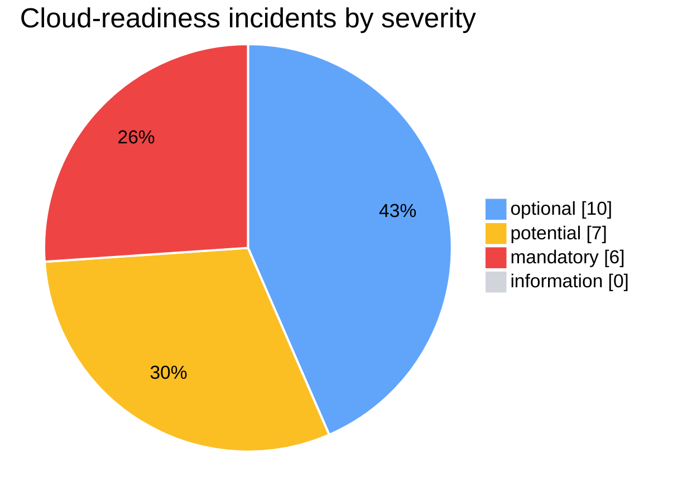
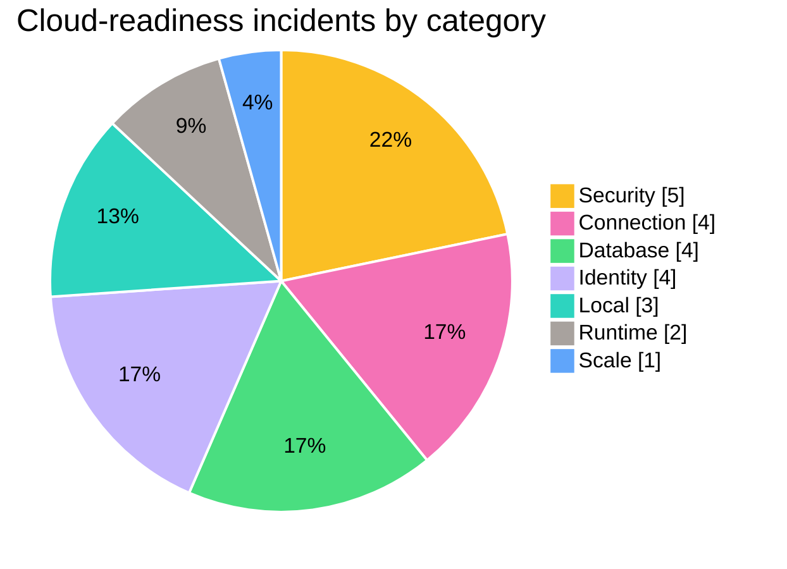
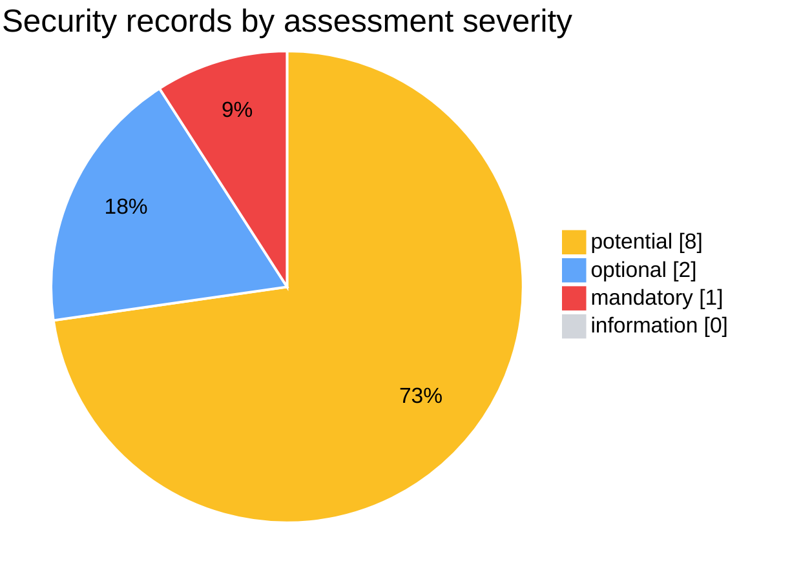
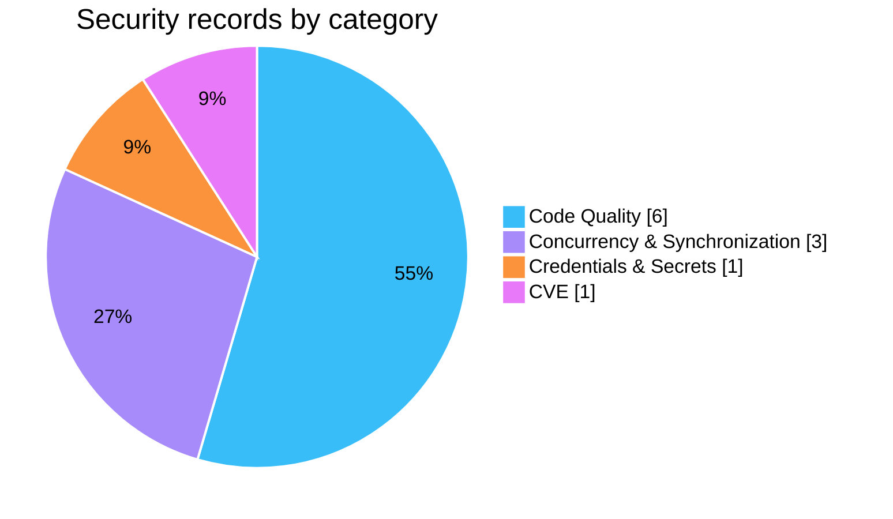
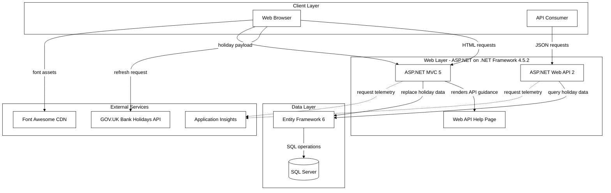
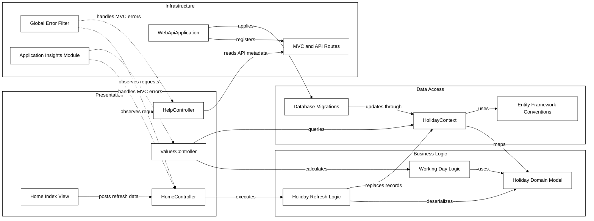
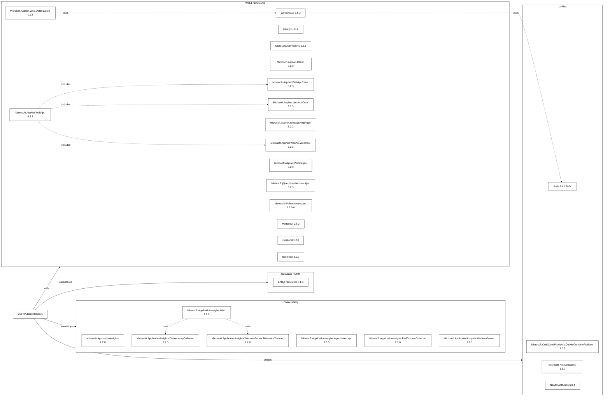
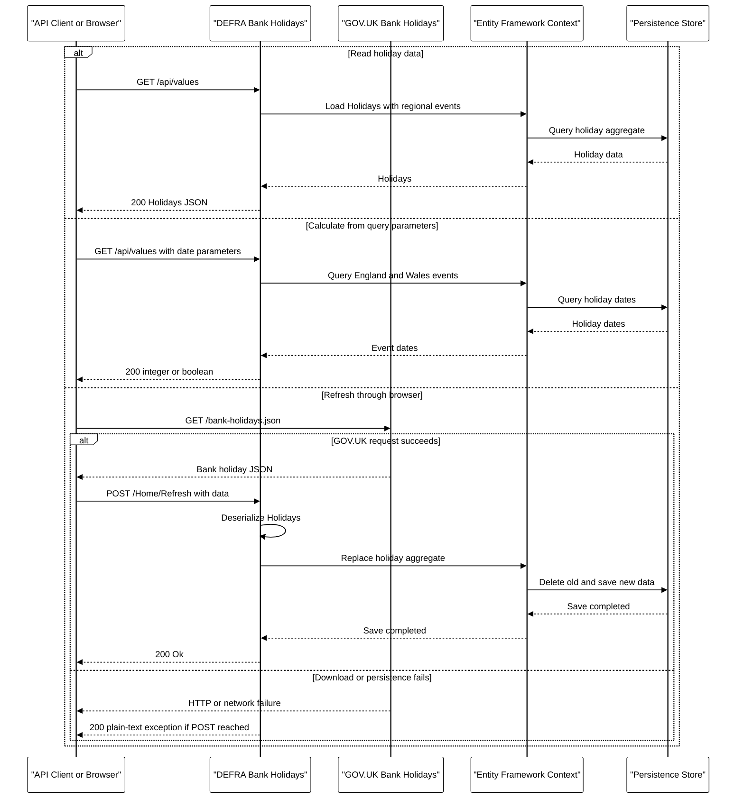
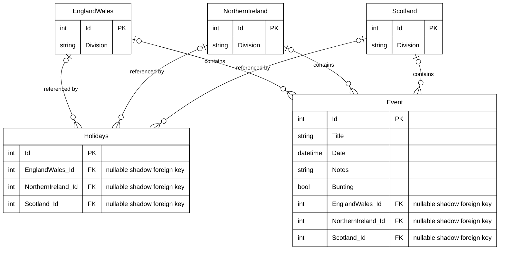
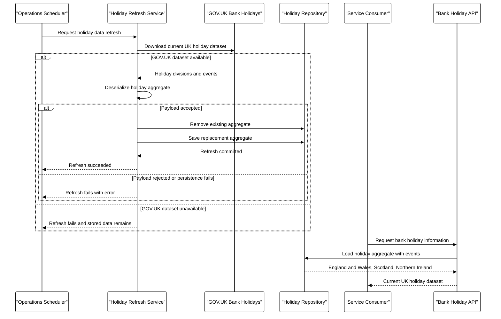

# Report_20261006091020

This is a Markdown export of the App Modernisation assessment for the DEFRA Bank Holidays solution. It merges two historical assessment runs from 6 October 2026: the cloud-readiness report `Report_20261006091020` (`.github/modernize/assessment/reports/report-20261006091020/`, including its supporting analysis in `facts/`) and the security report `Report_20261006093300` (`.github/modernize/assessment/reports/report-20261006093300/`). These are historical assessment results, not a fresh scan. Both source reports contain the same cloud-readiness findings, so those findings appear once here. The security records come only from `Report_20261006093300`. The original assessment artifacts are unchanged.

## Contents

1. [Assessment Metadata](#assessment-metadata)
2. [Assessment Summary](#assessment-summary)
3. [Cloud Readiness Findings (Azure Container Apps)](#cloud-readiness-findings-azure-container-apps)
4. [Security Findings](#security-findings)
5. [Migration Solution Mapping](#migration-solution-mapping)
6. [Supporting Analysis and Original Diagrams](#supporting-analysis-and-original-diagrams)

## Assessment Metadata

- **Reports merged:** `Report_20261006091020` (ID `20261006091020`, cloud readiness and supporting analysis) and `Report_20261006093300` (ID `20261006093300`, security and cloud readiness)
- **Format and producer:** report format version 1.0.0, produced by .NET AppCAT CLI (same for both reports)
- **Status and mode:** `20261006091020`: completed, `full` mode; `20261006093300`: completed, `issue-only` mode
- **Analysis window (`20261006091020`):** 2026-10-06 07:10:20.920 UTC to 2026-10-06 07:14:37.387 UTC
- **Analysis window (`20261006093300`):** 2026-10-06 07:33:00.186 UTC to 2026-10-06 07:35:49.049 UTC
- **Privacy mode:** Protected in both reports ([privacy mode help](https://aka.ms/appmod-privacy-mode)). The source redacts code snippets, for example connection-string attributes.
- **Selected target:** Azure Container Apps (`ACA`). Incident records also include ratings for 8 Azure compute targets; these are shown for each rule below.
- **Domains:** `20261006091020`: cloud-readiness; `20261006093300`: security, cloud-readiness
- **CVE settings:** minimum CVE severity `high`, scan scope `direct` (same in both reports)
- **Capabilities:** None specified; **operating systems:** None specified

### Merge and Source Notes

These notes describe how the two reports were merged and list source inconsistencies. Source values are kept as published; nothing was silently corrected.

- **Identical cloud-readiness data:** the summaries, rules, projects, incident locations, snippets and target ratings in both reports match exactly. Only the internal incident IDs differ, and those remain in the source `report.json` files. Both reports also have the same `solution.json` mapping.
- **Issue counts:** the source summary reports 7 issues, meaning distinct rule types across the solution. The per-project issue counts add up to 9 because `Runtime.0002` and `Security.0002` appear in both projects. Rule types are not incidents.
- **Summary scope:** the source `summary` block (totals and charts) covers only cloud readiness, including in `Report_20261006093300`. The security totals in this report are calculated from the 11 source security records.
- **Effort unit:** the source stores project effort as `storyPoints` and rule/incident effort as `effort`. Incident effort values add up to each project's `storyPoints`, so all effort values are shown as story points.
- **Path roots:** cloud-readiness locations are relative to the solution folder `DEFRA.BankHolidays/`. Security evidence paths are relative to the repository root and mix `/` and `\` separators. Links below are adjusted to resolve from `docs/`. The displayed path text matches the source.
- **Security category:** the source classifies `CWE-778` (Insufficient Logging) as `Credentials & Secrets`. That classification is preserved here, although the finding is about logging and auditing.
- **CVE severity scales:** `CVE-2024-21907` has assessment severity `mandatory`, and its GitHub advisory severity is `HIGH`. These scales are separate and are shown in separate columns.
- **CVE threshold:** `Report_20261006093300` contains one CVE record because the minimum CVE severity was `high`. The security engine's working output (`.github/modernize/assessment/engines/security/cve_assessment_result.json`, outside the report folder) also lists nine medium-severity advisories for `bootstrap@3.0.0` and `jQuery@1.10.2`. These are below the threshold, are not part of the report, and are not reproduced here.
- **`Identity.0002` evidence:** Windows authentication is flagged from the redacted snippet `<add name="HolidayContext" />`. The supporting configuration inventory states that the connection string uses `Integrated Security=True`. The source rule description ends with a stray `"` character, which is preserved.
- **Supporting analysis:** only `Report_20261006091020` (`full` mode) includes `facts/` documents. `Report_20261006093300` (`issue-only` mode) has none.

## Assessment Summary

| Group | Metric | Value |
|---|---|---:|
| Cloud readiness: overall | Projects | 2 |
| Cloud readiness: overall | Issues (distinct rule types) | 7 |
| Cloud readiness: overall | Incidents | 23 |
| Cloud readiness: overall | Effort (story points) | 63 |
| Cloud readiness: incidents by severity | mandatory | 6 |
| Cloud readiness: incidents by severity | potential | 7 |
| Cloud readiness: incidents by severity | optional | 10 |
| Cloud readiness: incidents by severity | information | 0 |
| Cloud readiness: incidents by category | Runtime | 2 |
| Cloud readiness: incidents by category | Scale | 1 |
| Cloud readiness: incidents by category | Connection | 4 |
| Cloud readiness: incidents by category | Database | 4 |
| Cloud readiness: incidents by category | Identity | 4 |
| Cloud readiness: incidents by category | Security | 5 |
| Cloud readiness: incidents by category | Local | 3 |
| Security: overall | Security records | 11 |
| Security: overall | CWE records | 10 |
| Security: overall | CVE records | 1 |
| Security: overall | Effort (story points) | 43 |
| Security: records by assessment severity | mandatory | 1 |
| Security: records by assessment severity | potential | 8 |
| Security: records by assessment severity | optional | 2 |
| Security: records by assessment severity | information | 0 |
| Security: records by category | Code Quality | 6 |
| Security: records by category | Concurrency & Synchronization | 3 |
| Security: records by category | Credentials & Secrets | 1 |
| Security: records by category | CVE | 1 |

Cloud-readiness and security effort are separate totals and are not added together. The security rows are calculated from the source security records because the source summary does not include them.

### Cloud-Readiness Incidents by Severity

Colour key: optional = blue (`#60A5FA`); potential = amber (`#FBBF24`); mandatory = red (`#EF4444`); information = grey (`#D1D5DB`). The `information` count is zero, so it has no visible slice.

### Cloud-Readiness Incidents by Category

Colour key: Security = amber (`#FBBF24`); Connection = pink (`#F472B6`); Database = green (`#4ADE80`); Identity = violet (`#C4B5FD`); Local = teal (`#2DD4BF`); Runtime = stone grey (`#A8A29E`); Scale = blue (`#60A5FA`). Category colours identify groups only. They do not indicate severity.

### Security Records by Assessment Severity

Colour key: potential = amber (`#FBBF24`); optional = blue (`#60A5FA`); mandatory = red (`#EF4444`); information = grey (`#D1D5DB`). The `information` count is zero, so it has no visible slice. This chart uses assessment severity, not advisory or CVSS severity.

### Security Records by Category

Colour key: Code Quality = sky blue (`#38BDF8`); Concurrency & Synchronization = purple (`#A78BFA`); Credentials & Secrets = orange (`#FB923C`); CVE = fuchsia (`#E879F9`). Category colours identify groups only. They do not indicate severity.

## Cloud Readiness Findings (Azure Container Apps)

The ratings below are for the selected target, Azure Container Apps (`ACA`), unless a table says otherwise.

### Project Overview

| Project | App Name | Framework | Language | Build Tool | Issues (rule types) | Incidents | Effort (story points) |
|---|---|---|---|---|---:|---:|---:|
| [DEFRA.BankHolidays/DEFRA.BankHolidays.csproj](../DEFRA.BankHolidays/DEFRA.BankHolidays/DEFRA.BankHolidays.csproj) | DEFRA.BankHolidays | .NETFramework,Version=v4.5.2 | C# | MSBuild | 7 | 21 | 57 |
| [DEFRA.BankHolidays.Tests/DEFRA.BankHolidays.Tests.csproj](../DEFRA.BankHolidays/DEFRA.BankHolidays.Tests/DEFRA.BankHolidays.Tests.csproj) | DEFRA.BankHolidays.Tests | .NETFramework,Version=v4.5.2 | C# | MSBuild | 2 | 2 | 6 |

### Findings Overview

| Rule | Title | Category | Rule Severity | ACA Severity | Incidents | Effort per Incident (story points) | Total Effort (story points) | Projects |
|---|---|---|---|---|---:|---:|---:|---|
| [`Runtime.0002`](#runtime0002-upgrade-to-newer-target-framework-to-get-better-cloud-experience) | Upgrade to newer target framework to get better cloud experience | Runtime | mandatory | mandatory | 2 | 3 | 6 | DEFRA.BankHolidays, DEFRA.BankHolidays.Tests |
| [`Scale.0001`](#scale0001-static-content-detected) | Static content detected | Scale | optional | optional | 1 | 3 | 3 | DEFRA.BankHolidays |
| [`Connection.0001`](#connection0001-connection-string-is-detected) | Connection string is detected | Connection | potential | potential | 4 | 3 | 12 | DEFRA.BankHolidays |
| [`Database.0003`](#database0003-systemdatasqlclient-dependency-detected) | System.Data.SqlClient dependency detected | Database | optional | optional | 4 | 3 | 12 | DEFRA.BankHolidays |
| [`Identity.0002`](#identity0002-windows-authentication-detected) | Windows authentication detected | Identity | mandatory | mandatory | 4 | 3 | 12 | DEFRA.BankHolidays |
| [`Security.0002`](#security0002-connection-strings-without-configuration-builders-detected) | Connection strings without configuration builders detected | Security | optional | optional | 5 | 3 | 15 | DEFRA.BankHolidays, DEFRA.BankHolidays.Tests |
| [`Local.0006`](#local0006-hardcoded-urls-detected) | Hardcoded URLs detected | Local | potential | potential | 3 | 1 | 3 | DEFRA.BankHolidays |

### Rule Guidance, Target Ratings and Incident Evidence

#### Runtime.0002 Upgrade to newer target framework to get better cloud experience

- **Rule severity:** mandatory; **effort per incident:** 3 story points; **category:** Runtime; **migration solution:** `runtime-compatibility-prompt`
- **Labels:** None specified

| Guidance | References |
|---|---|
| Upgrade to newer target framework to get better cloud experience.  If you are targeting Managed Instance on Azure App Service, validate on .NET Framework 4.8 or move to .NET 10. Persist any runtime prerequisites via install scripts; test in staging before production.  While if targeting other Azure compute services:  Application targeting .NET framework lower than 4.7.1 might missing features that would be needed for some cloud scenarios like scaling or getting secrets from secure external sources.  Azure App Service runs apps on .NET Framework 4.8 or .NET Framework 3.5. Apps running on on .NET Framework versions older than .NET Framework 4.8 could have potential compatibility issues. It is recommended to test your application running on .NET Framework 4.8. Note that it is not necessary to re-target to .NET Framework 4.8, only to validate that the app correctly runs on that version of .NET Framework.  In the long term it is also recommended to upgrade your application to latest supported .NET 8+ which would significantly increase performance of your application. Use tools like .NET Upgrade Assistant to help with upgrading your application to newer .NET. | [\[Managed Instance\] Install scripts](https://go.microsoft.com/fwlink/?linkid=2347059) [.NET Framework Breaking Changes](https://go.microsoft.com/fwlink/?linkid=2250029) [.NET Framework 4.8 on App Service](https://go.microsoft.com/fwlink/?linkid=2251730) [Upgrade to latest .NET with Upgrade Assistant](https://go.microsoft.com/fwlink/?LinkID=2202641) |

Target ratings, identical for all 2 incident(s):

| Target | Severity | Effort (story points) |
|---|---|---:|
| AppService.Windows | optional | 3 |
| AppService.Linux | mandatory | 3 |
| AKS.Linux | mandatory | 3 |
| AKS.Windows | information | 3 |
| **ACA** (selected) | mandatory | 3 |
| AppServiceContainer.Linux | mandatory | 3 |
| AppServiceContainer.Windows | information | 3 |
| AppServiceManagedInstance.Windows | optional | 3 |

| Project | Location | Line:Column | Kind | Evidence | Labels |
|---|---|---|---|---|---|
| DEFRA.BankHolidays | [DEFRA.BankHolidays/DEFRA.BankHolidays.csproj](../DEFRA.BankHolidays/DEFRA.BankHolidays/DEFRA.BankHolidays.csproj) | Not supplied | File | <code>Target framework: .NETFramework,Version=v4.5.2</code> | None |
| DEFRA.BankHolidays.Tests | [DEFRA.BankHolidays.Tests/DEFRA.BankHolidays.Tests.csproj](../DEFRA.BankHolidays/DEFRA.BankHolidays.Tests/DEFRA.BankHolidays.Tests.csproj) | Not supplied | File | <code>Target framework: .NETFramework,Version=v4.5.2</code> | None |

#### Scale.0001 Static content detected

- **Rule severity:** optional; **effort per incident:** 3 story points; **category:** Scale; **migration solution:** `local-file-to-azure-blob-storage`
- **Labels:** None specified

| Guidance | References |
|---|---|
| Static content detected.  Your current approach of serving static content directly might lead to increased costs, performance issues, maintenance challenges (requiring application redeployment for content changes), and security risks.  Consider moving static content to Azure Blob Storage and adding Azure CDN. | [Azure Blob Storage](https://go.microsoft.com/fwlink/?linkid=2250574) [Azure CDN](https://go.microsoft.com/fwlink/?linkid=2250392) |

Target ratings, identical for all 1 incident(s):

| Target | Severity | Effort (story points) |
|---|---|---:|
| AppService.Windows | optional | 3 |
| AppService.Linux | optional | 3 |
| AKS.Linux | optional | 3 |
| AKS.Windows | optional | 3 |
| **ACA** (selected) | optional | 3 |
| AppServiceContainer.Linux | optional | 3 |
| AppServiceContainer.Windows | optional | 3 |
| AppServiceManagedInstance.Windows | optional | 3 |

| Project | Location | Line:Column | Kind | Evidence | Labels |
|---|---|---|---|---|---|
| DEFRA.BankHolidays | [DEFRA.BankHolidays/DEFRA.BankHolidays.csproj](../DEFRA.BankHolidays/DEFRA.BankHolidays/DEFRA.BankHolidays.csproj) | Not supplied | File | <code>Found 19 files matching the rule:  Areas\HelpPage\HelpPage.css Content\bootstrap.css Content\bootstrap.min.css Content\Images\WebIcon.ico Content\Site.css favicon.ico fonts\glyphicons-halflings-regular.eot fonts\glyphicons-halflings-regular.svg fonts\glyphicons-halflings-regular.ttf fonts\glyphicons-halflings-regular.woff Scripts\bootstrap.js Scripts\bootstrap.min.js Scripts\jquery-1.10.2.js Scripts\jquery-1.10.2.min.js Scripts\jquery.unobtrusive-ajax.js Scripts\jquery.unobtrusive-ajax.min.js Scripts\modernizr-2.6.2.js Scripts\respond.js Scripts\respond.min.js</code> | None |

#### Connection.0001 Connection string is detected

- **Rule severity:** potential; **effort per incident:** 3 story points; **category:** Connection; **migration solution:** `plaintext-credential-to-azure-keyvault`
- **Labels:** None specified

| Guidance | References |
|---|---|
| Connection string detected. It may not be available when your app is migrated to Azure.  Review and ensure it works from Azure. If you are connecting to a database, you might need to migrate the database to Azure. There are multiple ways to do it:     1. Migrate to Azure SQL Database for additional benefits (see the link below).     2. Consider Azure SQL Managed Instance if you need features that are not available in Azure SQL Database and you don’t want to use a VM.     3. Migrate your database servers directly to SQL Server on Azure VMs.  To assess database migration effort, you can use Azure Migrate tool, see the link below. | [Migrate SQL Server database to Azure](https://go.microsoft.com/fwlink/?LinkID=2251731) [Azure SQL Managed Instance](https://go.microsoft.com/fwlink/?LinkID=2251613) [Azure Migrate](https://go.microsoft.com/fwlink/?linkid=2252410) |

Target ratings, identical for all 4 incident(s):

| Target | Severity | Effort (story points) |
|---|---|---:|
| AppService.Windows | potential | 3 |
| AppService.Linux | potential | 3 |
| AKS.Linux | potential | 3 |
| AKS.Windows | potential | 3 |
| **ACA** (selected) | potential | 3 |
| AppServiceContainer.Linux | potential | 3 |
| AppServiceContainer.Windows | potential | 3 |
| AppServiceManagedInstance.Windows | potential | 3 |

| Project | Location | Line:Column | Kind | Evidence | Labels |
|---|---|---|---|---|---|
| DEFRA.BankHolidays | [DEFRA.BankHolidays/Web.config](../DEFRA.BankHolidays/DEFRA.BankHolidays/Web.config) | Not supplied | File | <code>&lt;add name="HolidayContext" /&gt;</code> | None |
| DEFRA.BankHolidays | [DEFRA.BankHolidays/Web.Production.config](../DEFRA.BankHolidays/DEFRA.BankHolidays/Web.Production.config) | Not supplied | File | <code>&lt;add name="HolidayContext" /&gt;</code> | None |
| DEFRA.BankHolidays | [DEFRA.BankHolidays/Web.SIT.config](../DEFRA.BankHolidays/DEFRA.BankHolidays/Web.SIT.config) | Not supplied | File | <code>&lt;add name="HolidayContext" /&gt;</code> | None |
| DEFRA.BankHolidays | [DEFRA.BankHolidays/Web.UAT.config](../DEFRA.BankHolidays/DEFRA.BankHolidays/Web.UAT.config) | Not supplied | File | <code>&lt;add name="HolidayContext" /&gt;</code> | None |

#### Database.0003 System.Data.SqlClient dependency detected

- **Rule severity:** optional; **effort per incident:** 3 story points; **category:** Database; **migration solution:** `sqlclient-system-to-microsoft`
- **Labels:** None specified

| Guidance | References |
|---|---|
| System.Data.SqlClient dependency is detected.  While System.Data.SqlClient will work in Azure, the newer Microsoft.Data.SqlClient package is the primary .NET SQL client moving forward and receiving the latest features. For example, Microsoft.Data.SqlClient easily allows use of Azure Managed Identity from a connection string. | [https://go.microsoft.com/fwlink/?LinkID=2242668](https://go.microsoft.com/fwlink/?LinkID=2242668) |

Target ratings, identical for all 4 incident(s):

| Target | Severity | Effort (story points) |
|---|---|---:|
| AppService.Windows | optional | 3 |
| AppService.Linux | optional | 3 |
| AKS.Linux | optional | 3 |
| AKS.Windows | optional | 3 |
| **ACA** (selected) | optional | 3 |
| AppServiceContainer.Linux | optional | 3 |
| AppServiceContainer.Windows | optional | 3 |
| AppServiceManagedInstance.Windows | optional | 3 |

| Project | Location | Line:Column | Kind | Evidence | Labels |
|---|---|---|---|---|---|
| DEFRA.BankHolidays | [DEFRA.BankHolidays/Web.config](../DEFRA.BankHolidays/DEFRA.BankHolidays/Web.config) | Not supplied | File | <code>&lt;add name="HolidayContext" /&gt;</code> | None |
| DEFRA.BankHolidays | [DEFRA.BankHolidays/Web.Production.config](../DEFRA.BankHolidays/DEFRA.BankHolidays/Web.Production.config) | Not supplied | File | <code>&lt;add name="HolidayContext" /&gt;</code> | None |
| DEFRA.BankHolidays | [DEFRA.BankHolidays/Web.SIT.config](../DEFRA.BankHolidays/DEFRA.BankHolidays/Web.SIT.config) | Not supplied | File | <code>&lt;add name="HolidayContext" /&gt;</code> | None |
| DEFRA.BankHolidays | [DEFRA.BankHolidays/Web.UAT.config](../DEFRA.BankHolidays/DEFRA.BankHolidays/Web.UAT.config) | Not supplied | File | <code>&lt;add name="HolidayContext" /&gt;</code> | None |

#### Identity.0002 Windows authentication detected

- **Rule severity:** mandatory; **effort per incident:** 3 story points; **category:** Identity; **migration solution:** `windows-ad-to-azure-ad`
- **Labels:** None specified

| Guidance | References |
|---|---|
| Your app is using windows authentication which is not supported on Azure App Service, Azure Container Apps and Azure Kubernetes Service.  Azure App Service provides built-in authentication and authorization capabilities, so you can sign in users and access data by writing minimal or no code in your web app.  Follow the link below for more information." | [https://go.microsoft.com/fwlink/?LinkID=2242883](https://go.microsoft.com/fwlink/?LinkID=2242883) |

Target ratings, identical for all 4 incident(s):

| Target | Severity | Effort (story points) |
|---|---|---:|
| AppService.Windows | mandatory | 3 |
| AppService.Linux | mandatory | 3 |
| AKS.Linux | mandatory | 3 |
| AKS.Windows | potential | 3 |
| **ACA** (selected) | mandatory | 3 |
| AppServiceContainer.Linux | mandatory | 3 |
| AppServiceContainer.Windows | mandatory | 3 |
| AppServiceManagedInstance.Windows | mandatory | 3 |

| Project | Location | Line:Column | Kind | Evidence | Labels |
|---|---|---|---|---|---|
| DEFRA.BankHolidays | [DEFRA.BankHolidays/Web.config](../DEFRA.BankHolidays/DEFRA.BankHolidays/Web.config) | Not supplied | File | <code>&lt;add name="HolidayContext" /&gt;</code> | None |
| DEFRA.BankHolidays | [DEFRA.BankHolidays/Web.Production.config](../DEFRA.BankHolidays/DEFRA.BankHolidays/Web.Production.config) | Not supplied | File | <code>&lt;add name="HolidayContext" /&gt;</code> | None |
| DEFRA.BankHolidays | [DEFRA.BankHolidays/Web.SIT.config](../DEFRA.BankHolidays/DEFRA.BankHolidays/Web.SIT.config) | Not supplied | File | <code>&lt;add name="HolidayContext" /&gt;</code> | None |
| DEFRA.BankHolidays | [DEFRA.BankHolidays/Web.UAT.config](../DEFRA.BankHolidays/DEFRA.BankHolidays/Web.UAT.config) | Not supplied | File | <code>&lt;add name="HolidayContext" /&gt;</code> | None |

#### Security.0002 Connection strings without configuration builders detected

- **Rule severity:** optional; **effort per incident:** 3 story points; **category:** Security; **migration solution:** `plaintext-credential-to-azure-keyvault`
- **Labels:** None specified

| Guidance | References |
|---|---|
| Connection strings without configuration builders detected.     Keeping connection strings directly in the app is not the best practice and might introduce security risks, increased maintenance, scalability challenges or compliance standards (such as PCI DSS, GDPR, etc.).    Instead, it is recommended to use configuration builders to get secrets from secure sources in Azure environment. | [Configuration builders](https://go.microsoft.com/fwlink/?LinkID=2250915) [Storing application secrets](https://go.microsoft.com/fwlink/?LinkID=2250916) [Centralized app configuration and security](https://go.microsoft.com/fwlink/?LinkID=2250733) |

Target ratings, identical for all 5 incident(s):

| Target | Severity | Effort (story points) |
|---|---|---:|
| AppService.Windows | optional | 3 |
| AppService.Linux | optional | 3 |
| AKS.Linux | optional | 3 |
| AKS.Windows | optional | 3 |
| **ACA** (selected) | optional | 3 |
| AppServiceContainer.Linux | optional | 3 |
| AppServiceContainer.Windows | optional | 3 |
| AppServiceManagedInstance.Windows | optional | 3 |

| Project | Location | Line:Column | Kind | Evidence | Labels |
|---|---|---|---|---|---|
| DEFRA.BankHolidays | [DEFRA.BankHolidays/Web.config](../DEFRA.BankHolidays/DEFRA.BankHolidays/Web.config) | Not supplied | File | <code>&lt;connectionStrings /&gt;</code> | None |
| DEFRA.BankHolidays | [DEFRA.BankHolidays/Web.Production.config](../DEFRA.BankHolidays/DEFRA.BankHolidays/Web.Production.config) | Not supplied | File | <code>&lt;connectionStrings /&gt;</code> | None |
| DEFRA.BankHolidays | [DEFRA.BankHolidays/Web.SIT.config](../DEFRA.BankHolidays/DEFRA.BankHolidays/Web.SIT.config) | Not supplied | File | <code>&lt;connectionStrings /&gt;</code> | None |
| DEFRA.BankHolidays | [DEFRA.BankHolidays/Web.UAT.config](../DEFRA.BankHolidays/DEFRA.BankHolidays/Web.UAT.config) | Not supplied | File | <code>&lt;connectionStrings /&gt;</code> | None |
| DEFRA.BankHolidays.Tests | [DEFRA.BankHolidays.Tests/App.config](../DEFRA.BankHolidays/DEFRA.BankHolidays.Tests/App.config) | Not supplied | File | <code>&lt;connectionStrings /&gt;</code> | None |

#### Local.0006 Hardcoded URLs detected

- **Rule severity:** potential; **effort per incident:** 1 story points; **category:** Local; **migration solution:** `configuration-management-prompt`
- **Labels:** None specified

| Guidance | References |
|---|---|
| Your application has hardcoded URLs that might correspond to services that are not accessible on Azure.  Review and ensure that the application is attempting to access URLs that would be available from Azure. You might need to migrate those services to Azure too, this way you will get the benefit of lower latency in the cloud.  If your application needs to depend on services that run on-premises, you can connect your Azure and local networks with ExpressRoute, Hybrid Connections, or VPN solutions. | [ExpressRoute](https://go.microsoft.com/fwlink/?LinkID=2250577) [Hybrid Connections](https://go.microsoft.com/fwlink/?LinkID=2242588) [Connect an on-prem network](https://go.microsoft.com/fwlink/?LinkID=2242591) |

Target ratings, identical for all 3 incident(s):

| Target | Severity | Effort (story points) |
|---|---|---:|
| AppService.Windows | potential | 1 |
| AppService.Linux | potential | 1 |
| AKS.Linux | potential | 1 |
| AKS.Windows | potential | 1 |
| **ACA** (selected) | potential | 1 |
| AppServiceContainer.Linux | potential | 1 |
| AppServiceContainer.Windows | potential | 1 |
| AppServiceManagedInstance.Windows | potential | 1 |

| Project | Location | Line:Column | Kind | Evidence | Labels |
|---|---|---|---|---|---|
| DEFRA.BankHolidays | [DEFRA.BankHolidays/Controllers/HomeController.cs:52:45](../DEFRA.BankHolidays/DEFRA.BankHolidays/Controllers/HomeController.cs#L52) | 52:45 | File | <code>https://</code> | None |
| DEFRA.BankHolidays | [DEFRA.BankHolidays/Areas/HelpPage/App_Start/HelpPageConfig.cs:58:31](../DEFRA.BankHolidays/DEFRA.BankHolidays/Areas/HelpPage/App_Start/HelpPageConfig.cs#L58) | 58:31 | File | <code>http://</code> | None |
| DEFRA.BankHolidays | [DEFRA.BankHolidays/Areas/HelpPage/SampleGeneration/ObjectGenerator.cs:438:85](../DEFRA.BankHolidays/DEFRA.BankHolidays/Areas/HelpPage/SampleGeneration/ObjectGenerator.cs#L438) | 438:85 | File | <code>http://</code> | None |

## Security Findings

There are 11 security records from `Report_20261006093300`, one row per record. **Severity** is the assessment severity (`mandatory`, `potential`, `optional`, `information`). Advisory severity for CVEs is shown separately in the CVE detail table. File locations are source claims and were not re-verified against the current code.

| ID | Title | Category | Severity | Description | Files | Evidence | Effort (Story Points) |
|---|---|---|---|---|---|---|---:|
| [CWE-477](https://cwe.mitre.org/data/definitions/477.html) | Use of Obsolete Function | Code Quality | optional | The code uses deprecated or obsolete functions, which suggests that the code has not been actively reviewed or maintained. | [DEFRA.BankHolidays/DEFRA.BankHolidays/Controllers/HomeController.cs](../DEFRA.BankHolidays/DEFRA.BankHolidays/Controllers/HomeController.cs) | HomeController.Update() line 51 constructs System.Net.WebClient and calls DownloadString(); WebClient is an obsolete/deprecated HTTP API and should be replaced with HttpClient. | 1 |
| [CWE-570](https://cwe.mitre.org/data/definitions/570.html) | Expression is Always False | Code Quality | optional | The product contains an expression that will always evaluate to false. | [DEFRA.BankHolidays/DEFRA.BankHolidays/Controllers/ValuesController.cs](../DEFRA.BankHolidays/DEFRA.BankHolidays/Controllers/ValuesController.cs) | ValuesController.WorkingDays() line 51 tests total_days &lt; 0, but total_days is initialized to 0 at line 38 and is only incremented at line 47, so the expression cannot be true. | 1 |
| [CWE-606](https://cwe.mitre.org/data/definitions/606.html) | Unchecked Input for Loop Condition | Code Quality | potential | The product does not properly check inputs that are used for loop conditions, potentially leading to a denial of service or other consequences because of excessive looping. | [DEFRA.BankHolidays/DEFRA.BankHolidays/Controllers/ValuesController.cs](../DEFRA.BankHolidays/DEFRA.BankHolidays/Controllers/ValuesController.cs) | ValuesController.WorkingDays() line 43 uses the request-supplied end value directly as the upper bound of a day-by-day loop without validating the date range or imposing an iteration limit. | 3 |
| [CWE-682](https://cwe.mitre.org/data/definitions/682.html) | Incorrect Calculation | Code Quality | potential | The product performs a calculation that generates incorrect or unintended results that are later used in security-critical decisions or resource management. | [DEFRA.BankHolidays/DEFRA.BankHolidays/Controllers/ValuesController.cs](../DEFRA.BankHolidays/DEFRA.BankHolidays/Controllers/ValuesController.cs) | ValuesController.WorkingDays() lines 57-59 increments total_days for includeFirstDate whenever the start date is not a bank holiday, but does not exclude Saturday or Sunday as the main loop does, so a weekend start date can be incorrectly counted as a working day. | 5 |
| [CWE-772](https://cwe.mitre.org/data/definitions/772.html) | Missing Release of Resource after Effective Lifetime | Code Quality | potential | The product does not release a resource after its effective lifetime has ended, i.e., after the resource is no longer needed. | [DEFRA.BankHolidays/DEFRA.BankHolidays/Controllers/HomeController.cs](../DEFRA.BankHolidays/DEFRA.BankHolidays/Controllers/HomeController.cs) [DEFRA.BankHolidays/DEFRA.BankHolidays/Controllers/ValuesController.cs](../DEFRA.BankHolidays/DEFRA.BankHolidays/Controllers/ValuesController.cs) | HomeController lines 14-24 and ValuesController lines 15-25 retain disposable HolidayContext instances, but neither controller overrides Dispose(bool) to dispose the DbContext after the request. | 3 |
| [CWE-1057](https://cwe.mitre.org/data/definitions/1057.html) | Data Access Operations Outside of Expected Data Manager Component | Code Quality | potential | The product uses a dedicated, central data manager component as required by design, but it contains code that performs data-access operations that do not use this data manager. | [DEFRA.BankHolidays/DEFRA.BankHolidays/Controllers/HomeController.cs](../DEFRA.BankHolidays/DEFRA.BankHolidays/Controllers/HomeController.cs) [DEFRA.BankHolidays/DEFRA.BankHolidays/Controllers/ValuesController.cs](../DEFRA.BankHolidays/DEFRA.BankHolidays/Controllers/ValuesController.cs) | HomeController.Update(string) lines 63-68 and ValuesController.Get(), WorkingDays(), and IsBankHoliday() lines 30-68 directly query and mutate Entity Framework HolidayContext from controller classes instead of routing persistence operations through a dedicated data manager/repository component. | 5 |
| [CWE-567](https://cwe.mitre.org/data/definitions/567.html) | Unsynchronized Access to Shared Data in a Multithreaded Context | Concurrency &amp; Synchronization | potential | The product does not properly synchronize shared data, such as static variables across threads, which can lead to undefined behavior and unpredictable data changes. | [DEFRA.BankHolidays/DEFRA.BankHolidays/Areas/HelpPage/HelpPageConfigurationExtensions.cs](../DEFRA.BankHolidays/DEFRA.BankHolidays/Areas/HelpPage/HelpPageConfigurationExtensions.cs) [DEFRA.BankHolidays/DEFRA.BankHolidays/Areas/HelpPage/ModelDescriptions/ModelDescriptionGenerator.cs](../DEFRA.BankHolidays/DEFRA.BankHolidays/Areas/HelpPage/ModelDescriptions/ModelDescriptionGenerator.cs) | HelpPageConfigurationExtensions.GetModelDescriptionGenerator() caches one ModelDescriptionGenerator in HttpConfiguration.Properties at lines 204-209, so concurrent help-page requests share it. ModelDescriptionGenerator.GetOrCreateModelDescription() reads and mutates the shared non-concurrent GeneratedModels Dictionary without synchronization at lines 123 and 334, allowing concurrent reads/writes and duplicate Add operations. | 5 |
| [CWE-662](https://cwe.mitre.org/data/definitions/662.html) | Improper Synchronization | Concurrency &amp; Synchronization | potential | The product utilizes multiple threads or processes to allow temporary access to a shared resource that can only be exclusive to one process at a time, but it does not properly synchronize these actions, which might cause simultaneous accesses of this resource by multiple threads or processes. | [DEFRA.BankHolidays/DEFRA.BankHolidays/Areas/HelpPage/HelpPageConfigurationExtensions.cs](../DEFRA.BankHolidays/DEFRA.BankHolidays/Areas/HelpPage/HelpPageConfigurationExtensions.cs) [DEFRA.BankHolidays/DEFRA.BankHolidays/Areas/HelpPage/ModelDescriptions/ModelDescriptionGenerator.cs](../DEFRA.BankHolidays/DEFRA.BankHolidays/Areas/HelpPage/ModelDescriptions/ModelDescriptionGenerator.cs) | HelpPageConfigurationExtensions.GetModelDescriptionGenerator() exposes a cached ModelDescriptionGenerator to concurrent requests at lines 204-209. Its GetOrCreateModelDescription() method performs an unsynchronized check-then-add against GeneratedModels at lines 123 and 334, so simultaneous requests can race while creating model descriptions. | 8 |
| [CWE-820](https://cwe.mitre.org/data/definitions/820.html) | Missing Synchronization | Concurrency &amp; Synchronization | potential | The product utilizes a shared resource in a concurrent manner but does not attempt to synchronize access to the resource. | [DEFRA.BankHolidays/DEFRA.BankHolidays/Areas/HelpPage/HelpPageConfigurationExtensions.cs](../DEFRA.BankHolidays/DEFRA.BankHolidays/Areas/HelpPage/HelpPageConfigurationExtensions.cs) [DEFRA.BankHolidays/DEFRA.BankHolidays/Areas/HelpPage/ModelDescriptions/ModelDescriptionGenerator.cs](../DEFRA.BankHolidays/DEFRA.BankHolidays/Areas/HelpPage/ModelDescriptions/ModelDescriptionGenerator.cs) | The ModelDescriptionGenerator cached by HelpPageConfigurationExtensions.GetModelDescriptionGenerator() at lines 204-209 is shared application-wide. ModelDescriptionGenerator.GetOrCreateModelDescription() accesses and updates its GeneratedModels Dictionary at lines 123 and 334 without a lock or concurrent collection, leaving the shared cache unsynchronized. | 8 |
| [CWE-778](https://cwe.mitre.org/data/definitions/778.html) | Insufficient Logging | Credentials &amp; Secrets | potential | When a security-critical event occurs, the product either does not record the event or omits important details about the event when logging it. | [DEFRA.BankHolidays/DEFRA.BankHolidays/Controllers/HomeController.cs](../DEFRA.BankHolidays/DEFRA.BankHolidays/Controllers/HomeController.cs) | HomeController.Refresh() catches exceptions from the unauthenticated bank-holiday data replacement operation at line 42 but records no log or audit event, returning only the exception message to the caller. | 3 |
| CVE-2024-21907 | Improper Handling of Exceptional Conditions in Newtonsoft.Json | CVE | mandatory | [CVE-2024-21907](https://github.com/advisories/GHSA-5crp-9r3c-p9vr): Improper Handling of Exceptional Conditions in Newtonsoft.Json  Severity: HIGH  Affected dependencies:   - Newtonsoft.Json@6.0.4 (declared at DEFRA.BankHolidays\DEFRA.BankHolidays.Tests\packages.config:15, DEFRA.BankHolidays\DEFRA.BankHolidays\packages.config:28)  Recommended fix:   - Upgrade Newtonsoft.Json to 13.0.1 or later | [DEFRA.BankHolidays/DEFRA.BankHolidays.Tests/packages.config:15](../DEFRA.BankHolidays/DEFRA.BankHolidays.Tests/packages.config#L15) [DEFRA.BankHolidays/DEFRA.BankHolidays/packages.config:28](../DEFRA.BankHolidays/DEFRA.BankHolidays/packages.config#L28) | Source supplied no explanation; see description. | 1 |

CWE IDs link to the MITRE CWE definitions. These links were added for navigation and are not in the source.

### CVE Advisory Details

| CVE | Advisory | Advisory Severity | Assessment Severity | Affected Dependency | Declared At | Recommended Fix |
|---|---|---|---|---|---|---|
| CVE-2024-21907 | [GHSA-5crp-9r3c-p9vr](https://github.com/advisories/GHSA-5crp-9r3c-p9vr) | HIGH | mandatory | Newtonsoft.Json@6.0.4 | [DEFRA.BankHolidays/DEFRA.BankHolidays.Tests/packages.config:15](../DEFRA.BankHolidays/DEFRA.BankHolidays.Tests/packages.config#L15) [DEFRA.BankHolidays/DEFRA.BankHolidays/packages.config:28](../DEFRA.BankHolidays/DEFRA.BankHolidays/packages.config#L28) | Upgrade Newtonsoft.Json to 13.0.1 or later |

## Migration Solution Mapping

The mapping is the same in both source reports.

| Rule | Migration Solution |
|---|---|
| `Runtime.0002` | `runtime-compatibility-prompt` |
| `Scale.0001` | `local-file-to-azure-blob-storage` |
| `Connection.0001` | `plaintext-credential-to-azure-keyvault` |
| `Security.0002` | `plaintext-credential-to-azure-keyvault` |
| `Database.0003` | `sqlclient-system-to-microsoft` |
| `Identity.0002` | `windows-ad-to-azure-ad` |
| `Local.0006` | `configuration-management-prompt` |

## Supporting Analysis and Original Diagrams

These documents come from `.github/modernize/assessment/reports/report-20261006091020/facts/`. Their prose, tables, code and diagrams are preserved. Heading levels are lowered by two so the documents fit under this section. Mermaid styling is normalised to a black-and-white `base` theme through per-diagram configuration. Diagram nodes, relationships, labels and order are unchanged, and no syntax repairs were needed. This content is restyled and is not a byte-for-byte copy of the source files. The facts folder also contains a hidden `.facts-dispatched` marker file, which has no report content.

### Architecture Diagram

This document shows the runtime architecture of the DEFRA Bank Holidays service and the relationships between its principal application components. The application is a .NET Framework web application that combines MVC pages, a JSON Web API, Entity Framework persistence, and scheduled-on-start database migration.

#### Application Architecture

<!-- mermaid-checked: no \n, no em-dash/en-dash, no {} in labels, subgraphs are id["label"], arrows are -->|"label"|, all subgraphs closed by end, ids unique -->

##### Technology Stack Summary

| Layer | Technology | Version | Purpose |
|---|---|---:|---|
| Runtime | .NET Framework | 4.5.2 | Hosts the classic ASP.NET application and C# 6 code |
| Presentation | ASP.NET MVC | 5.2.3 | Serves the administrative home page, refresh workflow, and Razor views |
| API | ASP.NET Web API | 5.2.3 | Exposes bank holiday data and working-day calculations as JSON endpoints |
| API documentation | ASP.NET Web API Help Page | 5.2.3 | Generates endpoint and model documentation from Web API metadata |
| Client UI | Bootstrap and jQuery | 3.0.0 and 1.10.2 | Provides styling and AJAX-based refresh behavior |
| Serialization | Newtonsoft.Json | 6.0.4 | Deserializes GOV.UK holiday payloads and formats API data |
| Data access | Entity Framework | 6.1.3 | Maps holiday aggregates to relational tables and executes queries |
| Database | SQL Server | Configured instance | Stores UK division and holiday event records |
| Schema management | Entity Framework Migrations | 6.1.3 | Applies pending database migrations during application startup |
| Observability | Application Insights | 2.2.0 | Collects request, dependency, exception, and performance telemetry |

##### Data Storage & External Services

The `HolidayContext` Entity Framework context uses the `HolidayContext` SQL Server connection string and persists a `Holidays` aggregate containing England and Wales, Scotland, Northern Ireland, and their event collections. Holiday data is refreshed from the public GOV.UK bank holidays JSON endpoint, either through the browser-driven refresh flow or the server-side update action. Application Insights observes web requests, dependencies, exceptions, and performance counters, while the shared layout retrieves Font Awesome assets from a public CDN. No cache or message broker is present.

##### Key Architectural Decisions

- MVC and Web API are hosted in the same classic ASP.NET application and share the same Entity Framework context and domain model.
- Controllers access `HolidayContext` directly; constructor overloads permit context substitution for tests, but there is no separate service or repository layer.
- Pending Entity Framework migrations run synchronously during `Application_Start`, coupling application startup to database availability and schema upgrade success.

#### Component Relationships

<!-- mermaid-checked: no \n, no em-dash/en-dash, no {} in labels, subgraphs are id["label"], arrows are -->|"label"|, all subgraphs closed by end, ids unique -->

##### Component Inventory

| Component | Layer | Type | Responsibility |
|---|---|---|---|
| Home Index View | Presentation | Razor view | Presents refresh controls and API documentation navigation; sends the downloaded holiday payload to MVC |
| HomeController | Presentation | MVC controller | Serves the home page and coordinates replacement of persisted holiday data |
| ValuesController | Presentation | Web API controller | Returns the complete holiday aggregate, calculates working days, and checks holiday dates |
| HelpController | Presentation | MVC controller | Renders generated Web API endpoint and resource-model documentation |
| Holiday Refresh Logic | Business Logic | Controller-contained workflow | Deserializes a GOV.UK payload, removes existing records, inserts the new aggregate, and saves changes |
| Working Day Logic | Business Logic | Controller-contained workflow | Counts weekdays in a range while excluding England and Wales bank holidays |
| Holiday Domain Model | Business Logic | Entity aggregate | Represents UK divisions and their holiday events for JSON serialization and persistence |
| HolidayContext | Data Access | Entity Framework DbContext | Provides the holiday data set and SQL Server unit of work |
| Entity Framework Conventions | Data Access | Model configuration | Removes pluralized table naming from the Entity Framework model |
| Database Migrations | Data Access | Entity Framework migrations | Defines and applies the relational schema |
| WebApiApplication | Infrastructure | ASP.NET application bootstrap | Registers areas, routes, filters, bundles, and applies database migrations |
| MVC and API Routes | Infrastructure | Route configuration | Maps conventional MVC and Web API requests and enables attribute routes |
| Global Error Filter | Infrastructure | MVC filter | Applies the standard MVC error handler globally |
| Application Insights Module | Infrastructure | HTTP module and telemetry pipeline | Captures requests, dependencies, exceptions, performance counters, and sampling telemetry |

### Dependency Map

DEFRA.BankHolidays declares 28 application dependencies across its .NET Framework 4.5.2 web application. A further 16 packages are declared by the test project.

#### Dependencies

<!-- mermaid-checked: no \n, no em-dash/en-dash, no {} in labels, subgraphs are id["label"], arrows are -->|"label"|, all subgraphs closed by end, ids unique -->

##### Dependency Summary

| Category | Count | Key Libraries | Notes |
|---|---:|---|---|
| Web Frameworks | 16 | ASP.NET MVC 5.2.3, ASP.NET Web API 5.2.3, Razor 3.2.3, jQuery 1.10.2 | Legacy System.Web application stack with old client-side assets and packages.config management. |
| Database / ORM | 1 | Entity Framework 6.1.3 | Classic Entity Framework 6 with the SQL Server provider referenced by the project. |
| Observability | 7 | Application Insights 2.2.0, Web 2.2.0, DependencyCollector 2.2.0 | Application Insights is split across several legacy collector and channel packages. |
| Utilities | 4 | Newtonsoft.Json 6.0.4, CodeDom Providers 1.0.3, Microsoft.Net.Compilers 1.3.2 | Includes build-time compiler tooling and dependencies supporting web bundling and JSON serialization. |

##### Version & Compatibility Risks

The application targets .NET Framework 4.5.2, which has been out of support since April 2022. The declared ASP.NET MVC and Web API packages, Entity Framework 6.1.3, Application Insights 2.2.0, Newtonsoft.Json 6.0.4, jQuery 1.10.2, Bootstrap 3.0.0, and Microsoft.Net.Compilers 1.3.2 are all substantially behind current supported releases. Migration to modern .NET requires replacing the System.Web MVC/Web API stack with ASP.NET Core, evaluating Entity Framework Core or a supported EF6 release, and replacing the legacy Application Insights package set with current Azure Monitor and OpenTelemetry integration.

##### Notable Observations

- Dependency management uses packages.config rather than PackageReference or central package management.
- The Web API meta-package and its component packages are all declared, creating redundant top-level declarations.
- The Application Insights integration has a large legacy collector tree that will require coordinated replacement during modernization.
- Client-side dependencies are managed as NuGet packages and include obsolete jQuery, Bootstrap, Modernizr, and Respond versions.

#### Test Dependencies

| Framework | Version | Notes |
|---|---|---|
| Castle.Core | 4.2.1 | Dynamic proxy support used by mocking infrastructure. |
| EntityFramework | 6.2.0 | Test project declares a newer EF6 version than the application project. |
| EntityFrameworkTesting | 1.2.1 | Entity Framework test support. |
| EntityFrameworkTesting.Moq | 1.2.1 | Moq integration for Entity Framework testing. |
| Microsoft.AspNet.Mvc | 5.2.3 | Web framework dependency used by tests. |
| Microsoft.AspNet.Razor | 3.2.3 | Razor dependency used by tests. |
| Microsoft.AspNet.WebApi.Client | 5.2.3 | Web API client dependency used by tests. |
| Microsoft.AspNet.WebApi.Core | 5.2.3 | Web API core dependency used by tests. |
| Microsoft.AspNet.WebApi.WebHost | 5.2.3 | Web API hosting dependency used by tests. |
| Microsoft.AspNet.WebPages | 3.2.3 | Web Pages dependency used by tests. |
| Microsoft.Web.Infrastructure | 1.0.0.0 | ASP.NET infrastructure dependency used by tests. |
| Moq | 4.8.2 | Mocking framework. |
| Newtonsoft.Json | 6.0.4 | JSON serialization dependency used by tests. |
| NUnit3TestAdapter | 3.10.0 | NUnit 3 adapter is present, but no NUnit framework package is declared. |
| System.Threading.Tasks.Extensions | 4.3.0 | Compatibility support for task-related APIs. |
| System.ValueTuple | 4.4.0 | Compatibility support for value tuples. |

Total test-scope dependencies: 16

The test project also references the Visual Studio QualityTools unit test framework directly from the installed toolchain, while declaring NUnit3TestAdapter without an NUnit framework package. This mixed and outdated test setup may make test discovery and migration to modern .NET test tooling unreliable.

### API & Service Communication Contracts

The application exposes one unversioned ASP.NET Web API resource with three GET operations, three MVC application operations, and generated help-page routes. Communication is synchronous HTTP and in-process controller-to-data-access calls; there is no service-to-service messaging, gateway, discovery, or configured resilience policy.

#### Service Catalog

| Service | Port | Category | Purpose |
|---|---:|---|---|
| DEFRA.BankHolidays | 9066 for the checked-in local development profile; deployment port is host-managed | API Layer / Business | Hosts the MVC refresh UI, bank-holiday JSON API, working-day calculations, generated API help pages, and persistence access. Key dependencies are ASP.NET MVC 5.2.3, ASP.NET Web API 5.2.3, Entity Framework 6.1.3, Newtonsoft.Json 6.0.4, and Application Insights 2.2.0. |

`DEFRA.BankHolidays.Tests` is an MSTest project and is not independently deployable. No Docker Compose services, Kubernetes deployments, Helm charts, or infrastructure-as-code service definitions were found.

#### API Endpoints Inventory

The routes are convention-based and have no URL-, header-, or query-based API versioning. Web API uses `api/{controller}/{id}`; MVC uses `{controller}/{action}/{id}` with `Home/Index` as the default.

| Service | Method | Path | Request Type | Response Type |
|---|---|---|---|---|
| DEFRA.BankHolidays / `ValuesController.Get` | GET | `/api/values` | No body or required parameters | `Holidays` JSON; normally HTTP 200 |
| DEFRA.BankHolidays / `ValuesController.WorkingDays` | GET | `/api/values?start={DateTime}&end={DateTime}&includeFirstDate={bool}` | Required `start` and `end` query parameters; optional `includeFirstDate`, default `false` | Integer working-day count; normally HTTP 200 |
| DEFRA.BankHolidays / `ValuesController.IsBankHoliday` | GET | `/api/values?date={DateTime}` | Required `date` query parameter | Boolean; normally HTTP 200 |
| DEFRA.BankHolidays / `HomeController.Index` | GET | `/` or `/Home/Index` | No body | MVC HTML view; HTTP 200 |
| DEFRA.BankHolidays / `HomeController.Refresh` | POST | `/Home/Refresh` | Form value `data` containing a serialized GOV.UK bank-holiday JSON document | Plain text `Ok` on success; an exception message is also returned as plain text with HTTP 200 on failure |
| DEFRA.BankHolidays / `HomeController.Update` | POST | `/Home/Update` | No body | Empty response with explicit HTTP 200 after a server-side refresh; unhandled downstream or persistence failures follow the global error path |
| DEFRA.BankHolidays / `HelpController.Index` | GET | `/Help` or `/Help/Index` | No body | Generated API help index HTML; HTTP 200 |
| DEFRA.BankHolidays / `HelpController.Api` | GET | `/Help/Api/{apiId}` | Optional `apiId` path value | API help HTML or the MVC error view |
| DEFRA.BankHolidays / `HelpController.ResourceModel` | GET | `/Help/ResourceModel/{modelName}` | `modelName` path value | Model help HTML or the MVC error view |

Because all three Web API actions share `/api/values`, ASP.NET Web API selects the GET action from the query/route parameters that match each action signature. No explicit attribute route differentiates these operations.

#### Management & Observability Endpoints

| Service | Endpoint | Custom Metrics (if any) |
|---|---|---|
| DEFRA.BankHolidays | `/Help`, `/Help/Api/{apiId}`, `/Help/ResourceModel/{modelName}` | None; these are generated API documentation pages rather than health or metrics endpoints |
| DEFRA.BankHolidays | None for health, readiness, metrics, Prometheus, or Swagger/OpenAPI | No custom metric registrations were found. Application Insights automatically captures requests, dependencies, exceptions, performance counters, and live metrics through telemetry modules, but the application exposes no management endpoint for them. |

#### DTOs & Contracts

- `Holidays` is the top-level service response contract for `GET /api/values` and the deserialization target for refresh data. It is a mutable service-level entity/contract rather than a dedicated immutable DTO.
- `EnglandWales`, `Scotland`, `NorthernIreland`, and `Event` are mutable nested service-level contract classes used inside `Holidays`. There are no gateway-level aggregation DTOs because the application has no gateway or downstream service composition layer.
- `WorkingDays` and `IsBankHoliday` use primitive query parameters and return primitive JSON values (`int` and `bool`); no request classes are defined.
- `HomeController.Refresh` accepts the external JSON document as a form-bound `string`, then deserializes it to `Holidays`. Contract-invalid data can surface as the action's plain-text exception response rather than a structured error DTO.
- Newtonsoft.Json controls serialization. Identity properties are excluded with `JsonIgnore`, and explicit JSON names are supplied for the England-and-Wales and Northern-Ireland members. Web API also registers JSON for `text/html`, so the same JSON representation may be returned for either `application/json` or `text/html`.
- The generated ASP.NET Web API Help Page is the only API-description facility. No OpenAPI/Swagger document, GraphQL schema, or protobuf schema was found.

Entity fields and persistence mappings are intentionally left to `data-architecture.md`.

#### Communication Patterns

**Synchronous flows.** API and MVC controllers call `HolidayContext` directly in process through Entity Framework. Reads query the persistence store synchronously. Refresh writes remove the existing aggregate, add the downloaded aggregate, and save synchronously.

**External communication.** There are two refresh paths to the public GOV.UK JSON endpoint:

1. The home page issues a browser AJAX GET to `https://www.gov.uk/bank-holidays.json`, serializes the response, and then posts it as form data to `/Home/Refresh`.
2. `/Home/Update` uses `WebClient.DownloadString` to call the same HTTPS endpoint from the server before deserializing and persisting the response.

Although the browser uses AJAX callbacks, each HTTP exchange is request/response communication. No asynchronous message broker, event publication, queue, or background worker was found.

**Aggregation and gateway behavior.** There is no API gateway and no multi-service response composition. The `Holidays` response is assembled by Entity Framework eager-loading the three regional event collections from the application's own persistence context.

**Resilience.** No circuit breaker, retry, explicit timeout, bulkhead, fallback response, or idempotency policy is configured for the GOV.UK dependency or the database. The server-side refresh relies on `WebClient` defaults. `/Home/Refresh` catches all exceptions and returns the exception message as a success-status plain-text response; `/Home/Update` has no local fallback.

**Discovery and load balancing.** No service registry, logical service name, client-side load balancer, or dynamic discovery mechanism is used. The GOV.UK URL is hardcoded.

**Startup availability.** Database migrations run synchronously during application startup, so the API does not become available until migration completes successfully. Full startup and environment configuration belongs in `configuration-inventory.md`.

**Security posture.** The external GOV.UK call uses HTTPS, but the checked-in local application URL is HTTP and no application-level TLS requirement is configured. No authentication middleware, `[Authorize]` attributes, JWT/OAuth2/Basic authentication, role checks, or other API authorization controls were found; all MVC, refresh, help, and Web API routes are publicly reachable at the application layer. The state-changing refresh actions also have no anti-forgery attribute. Database integrated security is infrastructure authentication and does not protect the HTTP API.

#### Service Technology Matrix

| Service | Web | Data Access | Discovery | Gateway | Actuator / Health | Cache | Metrics |
|---|---|---|---|---|---|---|---|
| DEFRA.BankHolidays | ASP.NET MVC 5 and ASP.NET Web API 2 | Entity Framework 6 | None | None | None | None | Application Insights automatic request, dependency, exception, performance-counter, and live-metrics telemetry; no custom metrics endpoint |

#### Service Communication Sequence

<!-- mermaid-checked: every participant uses `participant Id as "Label"`, no \n in aliases/messages/notes, every alt/opt/loop closed by end, no `:` inside any alias -->

### Data Architecture & Persistence Layer

The application persists five closely related bank-holiday entities in a single SQL Server database through Entity Framework 6.1.3 Code First. The model is owned by one application module and uses direct `DbContext` queries rather than repository interfaces or a caching layer.

#### Database Configuration

| Service/Module | DB Type | Profile | Driver | Connection | Migration Tool |
|---|---|---|---|---|---|
| `DEFRA.BankHolidays` | SQL Server | Base, Debug, and Release | `System.Data.SqlClient` through the EF6 SQL Server provider | Local default SQL Server instance; `DEFRA.BankHolidays` catalog; Windows integrated authentication; multiple active result sets enabled; default ADO.NET connection pooling | EF6 Code First migrations. Automatic migrations are disabled; the explicit migration set is applied during application startup. |
| `DEFRA.BankHolidays` | SQL Server | SIT | `System.Data.SqlClient` through the EF6 SQL Server provider | Dedicated SIT SQL Server host; `DEFRA.BankHolidays` catalog; Windows integrated authentication; multiple active result sets enabled | Same EF6 migration configuration and startup migration behavior. |
| `DEFRA.BankHolidays` | SQL Server | UAT | `System.Data.SqlClient` through the EF6 SQL Server provider | Dedicated UAT SQL Server host; `DEFRA.BankHolidays` catalog; Windows integrated authentication; multiple active result sets enabled | Same EF6 migration configuration and startup migration behavior. |
| `DEFRA.BankHolidays` | SQL Server | Production | `System.Data.SqlClient` through the EF6 SQL Server provider | Dedicated production SQL Server host; `DEFRA.BankHolidays` catalog; Windows integrated authentication; multiple active result sets enabled | Same EF6 migration configuration and startup migration behavior. |

The initial migration creates all five tables, foreign keys, and foreign-key indexes. Foreign-key delete cascading is not enabled. The migration seed method is present but empty, so no application-owned seed data is installed. No explicit pool-size or timeout overrides were found. See `configuration-inventory.md` for the raw configuration property inventory.

#### Data Ownership per Service

| Service | Tables Owned | ORM Framework | Caching | Notes |
|---|---|---|---|---|
| `DEFRA.BankHolidays` | `Holidays`, `EnglandWales`, `Scotland`, `NorthernIreland`, `Event` | Entity Framework 6.1.3 Code First | None detected | One `HolidayContext` owns the complete schema. The pluralizing table-name convention is removed, so table names match entity class names. EF shadow foreign-key columns connect the aggregate and division event collections. |

#### Entity Model

All entity classes are declared in `DEFRA.BankHolidays/DEFRA.BankHolidays/Models/Holidays.cs`; the EF context is in `DEFRA.BankHolidays/DEFRA.BankHolidays/DAL/HolidayContext.cs`. The C# model exposes navigation properties but not scalar foreign-key properties, so EF materializes nullable shadow foreign-key columns in the physical schema. Relationships are unidirectional: `Holidays` references each division, and each division owns an `Events` collection. No explicit transaction scopes or transaction annotations were found; queries therefore use EF's normal per-operation behavior.

<!-- mermaid-checked: every attribute is `<type> <name> [<key>] ["<description>"]` with at most one of PK/FK/UK, no \n in descriptions, no {} in descriptions, every relationship label is double-quoted -->

The database does not enforce uniqueness on the three `Holidays` foreign keys, so the physical cardinality permits multiple `Holidays` rows to reference the same division row. Each `Event` can be associated with zero or one row from each division table, while each division can contain zero or many events.

#### Key Repository Methods

No repository interfaces or custom repository classes were found. Data access is performed directly against `HolidayContext.Holidays` from `DEFRA.BankHolidays/DEFRA.BankHolidays/Controllers/ValuesController.cs`.

| Service | Repository | Notable Methods | Purpose |
|---|---|---|---|
| `DEFRA.BankHolidays` | `HolidayContext` / `DbSet<Holidays>` | `Include(x => x.EnglandWales.Events).Include(x => x.NorthernIreland.Events).Include(x => x.Scotland.Events).FirstOrDefault()` returns `Holidays` | Eagerly loads the single holiday aggregate and all three regional event collections. |
| `DEFRA.BankHolidays` | `HolidayContext` / `DbSet<Holidays>` | `Include(x => x.EnglandWales.Events).FirstOrDefault()` returns `Holidays` | Loads England and Wales event dates for working-day calculations. |
| `DEFRA.BankHolidays` | `HolidayContext` / `DbSet<Holidays>` | `Where(x => x.EnglandWales.Events.Any(z => z.Date == date)).FirstOrDefault()` returns `Holidays` | Checks whether any England and Wales event matches a supplied date. |

There are no bulk query methods, named queries, raw SQL calls, stored procedures, or explicit asynchronous data-access methods.

#### Caching Strategy

No application cache provider, in-memory cache, distributed cache, EF second-level cache, cache annotations, cache regions, TTLs, or eviction policies were detected. Every request queries SQL Server directly through a newly constructed `HolidayContext`; therefore no cache-aside, read-through, write-through, or write-behind pattern is implemented. This keeps holiday data immediately consistent with the database, but repeated reads of the largely static holiday calendar continue to incur database queries.

#### Data Ownership Boundaries

The application has one service and one shared relational schema, so all persisted entities are inside the same ownership boundary. There is no database-per-service or schema-per-service separation, and no cross-service data access through APIs, messaging, or replicated read models.

Reads are performed directly through EF against the shared `Holidays` aggregate. The inspected application code contains no write commands after migration startup, no separate command/query models, and no CQRS implementation. Aggregation happens inside EF queries through eager loading and relationship predicates rather than through cross-service bulk methods.

##### Data Classification & Sensitivity

| Entity | Sensitive Fields | Classification (PII/PHI/PCI/None) | Controls in Place |
|---|---|---|---|
| `Holidays` | None | None | Database access uses Windows integrated authentication; no entity-level sensitive data identified. |
| `EnglandWales` | None | None | No field-level controls required for the detected fields. |
| `Scotland` | None | None | No field-level controls required for the detected fields. |
| `NorthernIreland` | None | None | No field-level controls required for the detected fields. |
| `Event` | None; title, date, notes, and bunting flag describe public holidays | None | No encryption, masking, or field-level access controls were found; no PII, PHI, or PCI fields were detected. |

No PII, PHI, or PCI data was detected in the entity model.

### Configuration & Externalized Settings Inventory

The solution uses XML configuration throughout: one application `Web.config`, five MSBuild build configurations with matching XDT transforms, two Razor view configuration files, a test `App.config`, and classic Application Insights settings. Secrets are not stored in source; SQL uses Windows Integrated Security and the absent Application Insights instrumentation key must be supplied outside the repository.

#### Configuration Sources

| Source | Type | Path/Location | Notes |
|---|---|---|---|
| Application configuration | ASP.NET `Web.config` | `DEFRA.BankHolidays/DEFRA.BankHolidays/Web.config` | Primary runtime configuration for application settings, SQL connection, ASP.NET, IIS modules/handlers, assembly redirects, CodeDOM, and Entity Framework. |
| Debug transform | XDT transform | `DEFRA.BankHolidays/DEFRA.BankHolidays/Web.Debug.config` | Contains only commented transform examples; makes no effective override. |
| Release transform | XDT transform | `DEFRA.BankHolidays/DEFRA.BankHolidays/Web.Release.config` | Empty transform; makes no effective override. |
| SIT transform | XDT transform | `DEFRA.BankHolidays/DEFRA.BankHolidays/Web.SIT.config` | Replaces the `HolidayContext` connection-string attributes for SIT. |
| UAT transform | XDT transform | `DEFRA.BankHolidays/DEFRA.BankHolidays/Web.UAT.config` | Replaces the `HolidayContext` connection-string attributes for UAT. |
| Production transform | XDT transform | `DEFRA.BankHolidays/DEFRA.BankHolidays/Web.Production.config` | Replaces the `HolidayContext` connection-string attributes for Production. |
| Main Razor view configuration | ASP.NET Razor `Web.config` | `DEFRA.BankHolidays/DEFRA.BankHolidays/Views/Web.config` | Configures the MVC Razor host, imported namespaces, direct-view blocking, and `webpages:Enabled`. |
| Help-page Razor configuration | ASP.NET Razor `Web.config` | `DEFRA.BankHolidays/DEFRA.BankHolidays/Areas/HelpPage/Views/Web.config` | Configures the Help Page Razor host, imported namespaces, direct-view blocking, and view compilation. |
| Application Insights configuration | SDK XML configuration | `DEFRA.BankHolidays/DEFRA.BankHolidays/ApplicationInsights.config` | Configures telemetry initializers, collectors, request handlers, adaptive sampling, and the server telemetry channel. No instrumentation key is committed. |
| Test configuration | .NET `App.config` | `DEFRA.BankHolidays/DEFRA.BankHolidays.Tests/App.config` | Test-only assembly redirects and Entity Framework provider configuration; app settings and connection strings are empty. |
| Application project | MSBuild project | `DEFRA.BankHolidays/DEFRA.BankHolidays/DEFRA.BankHolidays.csproj` | Defines target framework, build configurations, compiler symbols, IIS Express development settings, references, and package build imports. |
| Test project | MSBuild project | `DEFRA.BankHolidays/DEFRA.BankHolidays.Tests/DEFRA.BankHolidays.Tests.csproj` | Defines test build configurations, target framework, compiler symbols, references, and NUnit adapter import. |
| Solution configurations | Visual Studio solution | `DEFRA.BankHolidays/DEFRA.BankHolidays.sln` | Maps Debug, Release, SIT, UAT, and Production configurations to both projects. |
| Application package manifest | NuGet `packages.config` | `DEFRA.BankHolidays/DEFRA.BankHolidays/packages.config` | Pins legacy application dependencies. |
| Test package manifest | NuGet `packages.config` | `DEFRA.BankHolidays/DEFRA.BankHolidays.Tests/packages.config` | Pins legacy test dependencies. |

No `appsettings*.json`, `launchSettings.json`, environment files, publish profiles, Docker Compose files, Kubernetes manifests, remote configuration-server references, Key Vault/Vault references, or external configuration repository references were found.

#### Build Profiles

All profiles are selected through the Visual Studio/MSBuild `Configuration` property, for example `/p:Configuration=SIT`; `Any CPU` is the only solution platform. No profile changes package dependencies or MSBuild plugins.

| Profile | Activation | Purpose | Key Dependencies/Plugins |
|---|---|---|---|
| Debug | Default when `$(Configuration)` is empty, or manual `Debug|Any CPU` selection | Local development build; full symbols, no optimization, `DEBUG;TRACE`. The web project outputs to `bin\`; tests output to `bin\Debug\`. | Application imports CodeDOM Provider 1.0.3 and Microsoft.Net.Compilers 1.3.2 props. Test project imports NUnit3TestAdapter 3.10.0 props. |
| Release | Manual `Release|Any CPU` selection | Optimized release build with PDB-only debug information and `TRACE`. Web transform is empty. | Same dependencies/plugins as Debug. |
| SIT | Manual `SIT|Any CPU` selection | Optimized deployment build with PDB-only debug information, `TRACE`, AnyCPU, and minimum recommended code-analysis rules; applies the SIT XDT connection override when packaging/publishing. | Same dependencies/plugins as Debug. |
| UAT | Manual `UAT|Any CPU` selection | Optimized deployment build with PDB-only debug information, `TRACE`, AnyCPU, and minimum recommended code-analysis rules; applies the UAT XDT connection override when packaging/publishing. | Same dependencies/plugins as Debug. |
| Production | Manual `Production|Any CPU` selection | Optimized deployment build with PDB-only debug information, `TRACE`, AnyCPU, and minimum recommended code-analysis rules; applies the Production XDT connection override when packaging/publishing. | Same dependencies/plugins as Debug. |

The application project has `MvcBuildViews=false`, so Razor views are not precompiled by the optional `MvcBuildViews` target. Missing legacy NuGet build imports fail the build and require package restore.

#### Runtime Profiles

The application does not use `ASPNETCORE_ENVIRONMENT`, environment-specific `appsettings` files, runtime profile APIs, or environment-variable branching. Environment composition is build/package-time XDT transformation rather than runtime profile activation.

| Profile | Activation Method | Config Files | Key Overrides |
|---|---|---|---|
| Base/local | Run the untransformed application, normally under IIS Express | `Web.config` | `HolidayContext` uses local SQL Server (`Data Source=.`); ASP.NET compilation debug is `true`. |
| Debug | Build/package with `Configuration=Debug` | `Web.config` + `Web.Debug.config` | No effective overrides; the transform contains comments only. |
| Release | Build/package with `Configuration=Release` | `Web.config` + `Web.Release.config` | No effective overrides; the transform is empty. |
| SIT | Build/package with `Configuration=SIT` | `Web.config` + `Web.SIT.config` | Replaces `HolidayContext` data source with `D3VMDVWDEV002`. |
| UAT | Build/package with `Configuration=UAT` | `Web.config` + `Web.UAT.config` | Replaces `HolidayContext` data source with `D3VMPPWSQL003`. |
| Production | Build/package with `Configuration=Production` | `Web.config` + `Web.Production.config` | Replaces `HolidayContext` data source with `D3VMPRWSQL003`. |
| Tests | Start the test assembly | `DEFRA.BankHolidays.Tests/App.config` | No test app settings or connection strings; supplies test assembly redirects and the EF SQL provider. |

Profiles do not compose: one MSBuild configuration and its correspondingly named transform are selected for a build.

#### Properties Inventory

##### DEFRA.BankHolidays application

| Property Key | Default | Profiles | Source |
|---|---|---|---|
| `appSettings.webpages:Version` | `3.0.0.0` | All | `Web.config` |
| `appSettings.webpages:Enabled` | `false` | All; repeated as `false` in both Razor view configs | `Web.config`, `Views/Web.config`, `Areas/HelpPage/Views/Web.config` |
| `appSettings.ClientValidationEnabled` | `true` | All | `Web.config` |
| `appSettings.UnobtrusiveJavaScriptEnabled` | `true` | All | `Web.config` |
| `connectionStrings.HolidayContext.providerName` | `System.Data.SqlClient` | All | `Web.config`; retained by SIT/UAT/Production transforms |
| `connectionStrings.HolidayContext.connectionString` | `Data Source=.; Initial Catalog=DEFRA.BankHolidays; Integrated Security=True; MultipleActiveResultSets=True;` | Base, Debug, Release | `Web.config` |
| `connectionStrings.HolidayContext.connectionString` | `Data Source=D3VMDVWDEV002; Initial Catalog=DEFRA.BankHolidays; Integrated Security=True; MultipleActiveResultSets=True;` | SIT | `Web.SIT.config`, matched by connection-string name and applied with `SetAttributes` |
| `connectionStrings.HolidayContext.connectionString` | `Data Source=D3VMPPWSQL003; Initial Catalog=DEFRA.BankHolidays; Integrated Security=True; MultipleActiveResultSets=True;` | UAT | `Web.UAT.config`, matched by connection-string name and applied with `SetAttributes` |
| `connectionStrings.HolidayContext.connectionString` | `Data Source=D3VMPRWSQL003; Initial Catalog=DEFRA.BankHolidays; Integrated Security=True; MultipleActiveResultSets=True;` | Production | `Web.Production.config`, matched by connection-string name and applied with `SetAttributes` |
| `system.web.compilation.debug` | `true` | All; no transform overrides it | `Web.config` |
| `system.web.compilation.targetFramework` | `4.5.2` | All | `Web.config` |
| `system.web.httpRuntime.targetFramework` | `4.5.2` | All | `Web.config` |
| `system.net.defaultProxy.enabled` | `true` | All | `Web.config` |
| `system.net.defaultProxy.useDefaultCredentials` | `false` | All | `Web.config` |
| `system.webServer.validation.validateIntegratedModeConfiguration` | `false` | All | `Web.config` |
| `system.webServer.handlers.ExtensionlessUrlHandler-Integrated-4.0` | Path `*.`, verb `*`, integrated pipeline/runtime v4.0 | All | `Web.config` |
| `system.webServer.modules.ApplicationInsightsWebTracking` | `Microsoft.ApplicationInsights.Web.ApplicationInsightsHttpModule` with `managedHandler` precondition | All | `Web.config` |
| `system.codedom.csharp.warningLevel` | `4` | All | `Web.config` |
| `system.codedom.csharp.compilerOptions` | `/langversion:6 /nowarn:1659;1699;1701` | All | `Web.config` |
| `system.codedom.visualbasic.warningLevel` | `4` | All | `Web.config` |
| `system.codedom.visualbasic.compilerOptions` | `/langversion:14 /nowarn:41008 /define:_MYTYPE="Web" /optionInfer+` | All | `Web.config` |
| `entityFramework.defaultConnectionFactory` | `System.Data.Entity.Infrastructure.SqlConnectionFactory` | All | `Web.config` |
| `entityFramework.providers.System.Data.SqlClient` | `System.Data.Entity.SqlServer.SqlProviderServices` | All | `Web.config` |
| `runtime.bindingRedirect.Newtonsoft.Json` | `6.0.0.0` | All | `Web.config` |
| `runtime.bindingRedirect.System.Web.Optimization` | `1.1.0.0` | All | `Web.config` |
| `runtime.bindingRedirect.WebGrease` | `1.5.2.14234` | All | `Web.config` |
| `runtime.bindingRedirect.System.Web.Helpers` | `3.0.0.0` | All | `Web.config` |
| `runtime.bindingRedirect.System.Web.WebPages` | `3.0.0.0` | All | `Web.config` |
| `runtime.bindingRedirect.System.Web.Mvc` | `5.2.3.0` | All | `Web.config` |

No `${ENV_VAR}`, `%ENV_VAR%`, external file indirection, or environment-variable property sources were found. The effective resolution chain is base `Web.config` followed by the single XDT transform selected during package/publish; code then resolves `HolidayContext` by the Entity Framework context name convention.

##### Razor view configuration

| Property Key | Default | Profiles | Source |
|---|---|---|---|
| `system.web.webPages.razor.host.factoryType` | MVC Razor host, version `5.2.3.0` | All | Both Razor `Web.config` files |
| `system.web.webPages.razor.pages.pageBaseType` | `System.Web.Mvc.WebViewPage` | Main views only | `Views/Web.config` |
| `system.web.webPages.razor.pages.namespaces` | MVC, Ajax, Html, Optimization, Routing, application namespace | All | `Views/Web.config` |
| `system.web.webPages.razor.pages.namespaces` | MVC, Ajax, Html, Routing | All | `Areas/HelpPage/Views/Web.config` |
| `system.webServer.handlers.BlockViewHandler` | Reject direct view requests with `System.Web.HttpNotFoundHandler` | All | Both Razor `Web.config` files |
| `system.web.compilation.debug` | `true` | Help Page views | `Areas/HelpPage/Views/Web.config` |

##### Application Insights

| Property Key | Default | Profiles | Source |
|---|---|---|---|
| `ApplicationInsights.TelemetryInitializers` | 13 initializers covering dependencies, Azure role metadata, build metadata, synthetic traffic, operation correlation, user/account/session context | All | `ApplicationInsights.config` |
| `SyntheticUserAgentTelemetryInitializer.Filters` | `search\|spider\|crawl\|Bot\|Monitor\|AlwaysOn` | All | `ApplicationInsights.config` |
| `ApplicationInsights.TelemetryModules` | Dependency tracking, performance counters, live metrics, debugger mode, unhandled/unobserved exceptions, request tracking, exception tracking | All | `ApplicationInsights.config` |
| `RequestTrackingTelemetryModule.Handlers` | Nine framework/static/resource handlers excluded from normal request tracking | All | `ApplicationInsights.config` |
| `AdaptiveSamplingTelemetryProcessor.MaxTelemetryItemsPerSecond` | `5` (positive integer items/second) | All | `ApplicationInsights.config` |
| `ApplicationInsights.TelemetryChannel` | `ServerTelemetryChannel` | All | `ApplicationInsights.config` |
| `ApplicationInsights.InstrumentationKey` | Not present | All | Must be provided out-of-band if telemetry export is required |

##### DEFRA.BankHolidays.Tests

| Property Key | Default | Profiles | Source |
|---|---|---|---|
| `appSettings` | Empty | Tests | `DEFRA.BankHolidays.Tests/App.config` |
| `connectionStrings` | Empty | Tests | `DEFRA.BankHolidays.Tests/App.config` |
| `entityFramework.defaultConnectionFactory` | `System.Data.Entity.Infrastructure.SqlConnectionFactory` | Tests | `DEFRA.BankHolidays.Tests/App.config` |
| `entityFramework.providers.System.Data.SqlClient` | `System.Data.Entity.SqlServer.SqlProviderServices` | Tests | `DEFRA.BankHolidays.Tests/App.config` |
| `runtime.bindingRedirect.WebGrease` | `1.5.2.14234` | Tests | `DEFRA.BankHolidays.Tests/App.config` |
| `runtime.bindingRedirect.Newtonsoft.Json` | `6.0.0.0` | Tests | `DEFRA.BankHolidays.Tests/App.config` |
| `runtime.bindingRedirect.Moq` | `4.8.0.0` | Tests | `DEFRA.BankHolidays.Tests/App.config` |

#### Startup Parameters & Resource Requirements

| Service | JVM/Runtime Options | Memory | Instance Count |
|---|---|---|---|
| DEFRA.BankHolidays web application | IIS-hosted .NET Framework 4.5.2 application; local project server is IIS Express at `http://localhost:9066/`; application target is AnyCPU. No command-line options, environment overrides, explicit CLR settings, or startup system properties are defined. | Not specified in source. No container, IIS app-pool, cloud-plan, or deployment memory limit is committed. | Not specified; no autoscaling or replica configuration is committed. |
| DEFRA.BankHolidays.Tests | .NET Framework 4.5.2 test assembly; AnyCPU; NUnit3TestAdapter 3.10.0 is imported for discovery/execution. | Not specified. | Not applicable. |

No JVM heap settings, container CPU/memory limits, deployment slot settings, or instance-scaling rules were found.

#### Startup Dependency Chain

1. **IIS/IIS Express host → loads → DEFRA.BankHolidays application** using the deployed `Web.config`. Local IIS Express is configured for automatic port assignment with development port `9066`.
2. **DEFRA.BankHolidays application → runs → ASP.NET startup registration** for areas, Web API, filters, routes, and bundles in `Application_Start`.
3. **DEFRA.BankHolidays application → waits for → SQL Server (`HolidayContext`)** implicitly during startup: `Application_Start` constructs an Entity Framework migrator and calls `Update()`. Startup cannot complete successfully if the selected SQL host is unavailable, Windows authentication fails, or a required migration fails.
4. **DEFRA.BankHolidays application → emits to → Application Insights** through registered modules when a valid instrumentation key is supplied externally. Telemetry is not coded as a readiness dependency.

No explicit health endpoint dependency, IIS warm-up configuration, startup timeout, retry policy, wait-for-TCP script, Docker Compose `depends_on`, Kubernetes readiness/liveness probe, or service discovery/config-server dependency was found.

#### Secrets & Sensitive Configuration

| Secret Reference | Type | Storage (masked) |
|---|---|---|
| `connectionStrings.HolidayContext` | SQL Server connection string | Committed per environment, but contains no password or user name. Authentication is `Integrated Security=True`, so the effective secret is the Windows/IIS process identity credential managed outside source. |
| `ApplicationInsights.InstrumentationKey` | Telemetry credential | Not present in `ApplicationInsights.config` or `Web.config`; expected to be supplied out-of-band. Value: `[MASKED / NOT COMMITTED]`. |

No plaintext passwords, API keys, certificate passwords, encrypted configuration sections, Key Vault references, Vault paths, AWS Secrets Manager references, DPAPI configuration, Jasypt values, or sealed secrets were found.

##### Secrets Provisioning Workflow

The repository does not contain deployment automation or a documented provisioning workflow. Based on the committed configuration, deployment must first assign the IIS application-pool or host process a Windows identity that can authenticate to the selected SQL Server and database; the XDT transform then binds the environment-specific SQL host while retaining Integrated Security. If Application Insights is enabled, deployment or server administration must inject the instrumentation key into the effective configuration without committing it. No managed identity, service principal, RBAC assignment, secret-store retrieval, rotation mechanism, or CI/CD secret binding is defined in this workspace.

#### Feature Flags

| Flag Name | Default | Controlled By |
|---|---|---|
| `webpages:Enabled` | `false` | Static `Web.config` and Razor view configuration. This is a framework switch, not a business feature flag. |
| `ClientValidationEnabled` | `true` | Static `Web.config`. This is an MVC framework behavior switch. |
| `UnobtrusiveJavaScriptEnabled` | `true` | Static `Web.config`. This is an MVC framework behavior switch. |
| C# `DEBUG` compilation symbol | Enabled only for Debug | MSBuild `Configuration=Debug`; all other configurations define only `TRACE`. |
| Help Page `Handle_PageResultOfT` symbol | Disabled | Source-level preprocessor symbol is commented out and not defined by any project configuration. |

No LaunchDarkly, Unleash, .NET FeatureManagement, custom runtime feature-toggle service, `Conditional` attribute, gradual rollout, A/B test, or remote flag provider was found.

#### Framework & Runtime Versions

| Component | Version | Source |
|---|---|---|
| Visual Studio solution format | Format 12.00; Visual Studio 15 metadata (`15.0.26430.16`) | `DEFRA.BankHolidays.sln` |
| MSBuild project tools | `15.0` | Both `.csproj` files |
| .NET Framework | `4.5.2` | Both `.csproj` files and application `Web.config` |
| CLR/IIS pipeline | CLR v4.0 integrated mode | Application handler precondition in `Web.config` |
| C# language version | `6` | CodeDOM compiler options in `Web.config` |
| ASP.NET MVC | NuGet `5.2.3` | Application and test `packages.config` |
| ASP.NET Web API | NuGet `5.2.3` | Application and test `packages.config` |
| ASP.NET Razor / Web Pages | Razor `3.2.3`; Web Pages `3.2.3` | Application and test `packages.config` |
| Entity Framework | Application `6.1.3`; tests `6.2.0` | Respective `packages.config` files |
| Application Insights | Core/Web/collectors `2.2.0`; Agent.Intercept `2.0.6` | Application `packages.config` |
| Newtonsoft.Json | NuGet `6.0.4`; assembly redirect `6.0.0.0` | Both `packages.config` files and config redirects |
| Microsoft.CodeDom.Providers.DotNetCompilerPlatform | `1.0.3` | Application `packages.config` and `.csproj` import |
| Microsoft.Net.Compilers | `1.3.2` | Application `packages.config` and `.csproj` import |
| NUnit test adapter | `3.10.0` | Test `packages.config` and `.csproj` import |
| Moq | `4.8.2` | Test `packages.config` |
| EntityFrameworkTesting / EntityFrameworkTesting.Moq | `1.2.1` | Test `packages.config` |
| Bootstrap | `3.0.0` | Application `packages.config` |
| jQuery | `1.10.2` | Application `packages.config` |
| Modernizr | `2.6.2` | Application `packages.config` |
| IIS Express development host | Version not pinned; enabled by the project | Application `.csproj` |
| NuGet client/build tool | Version not pinned; legacy `packages.config` restore model | Both `packages.config` files and `.csproj` package imports |
| Docker/container base image | None | No Dockerfile or container manifest found |

### Core Business Workflows

DEFRA.BankHolidays maintains and publishes a local reference copy of the official UK bank-holiday calendar. Consumers can retrieve holidays for all UK divisions, determine whether an England and Wales date is a bank holiday, and calculate working days between two dates.

#### Domain Entities

| Entity | Service / Bounded Context | Description | Key Relationships |
|---|---|---|---|
| Holidays | Holiday Calendar Management | Aggregate root representing the currently published UK bank-holiday dataset. A refresh replaces this aggregate as a complete snapshot. | Owns one calendar division for England and Wales, Scotland, and Northern Ireland. |
| EnglandWales | Holiday Calendar Management | Calendar division containing holidays observed in England and Wales. It is also the division used by the date-checking and working-day rules. | Belongs to the Holidays aggregate and owns its holiday events. |
| Scotland | Holiday Calendar Management | Calendar division containing holidays observed in Scotland. | Belongs to the Holidays aggregate and owns its holiday events. |
| NorthernIreland | Holiday Calendar Management | Calendar division containing holidays observed in Northern Ireland. | Belongs to the Holidays aggregate and owns its holiday events. |
| Event | Holiday Calendar Management | A named bank-holiday occurrence, including its date, explanatory notes, and whether ceremonial bunting is expected. | Belongs to exactly one calendar division in the imported aggregate. |

#### Service-to-Domain Mapping

| Service | Domain Context | Owned Entities | External Dependencies |
|---|---|---|---|
| DEFRA.BankHolidays web application | Holiday Calendar Management and Publication | Holidays, EnglandWales, Scotland, NorthernIreland, Event | GOV.UK bank-holiday JSON feed for source data; HolidayContext repository for the published snapshot |
| HomeController refresh surface | Calendar Synchronization | Replaces the Holidays aggregate and its divisions and events | GOV.UK feed for server-side refreshes; browser-supplied GOV.UK payload for interactive refreshes |
| ValuesController API surface | Calendar Querying | Read-only use of the Holidays aggregate and Event dates | HolidayContext repository |

The application is a single deployable service and a single bounded context. The local repository is the source of truth for data served to consumers, while GOV.UK is the upstream authority used to replace that local snapshot.

#### Primary Workflows

##### Workflow 1: Refresh the Published Holiday Calendar

This workflow can begin from the home-page refresh button, `POST /Home/Update`, or the supplied PowerShell update command.

1. An operator initiates a refresh.
2. For the home-page path, the browser downloads `https://www.gov.uk/bank-holidays.json`, serializes the response, and posts it to `POST /Home/Refresh`. For the server-side path, the application downloads the same GOV.UK document itself.
3. The refresh service deserializes the document into one Holidays aggregate containing the three UK divisions and their events.
4. The application removes every existing Holidays aggregate from the repository.
5. It adds the newly deserialized aggregate and commits the changes in one `SaveChanges` call.
6. A successful interactive refresh returns `Ok`; the server-side endpoint returns HTTP 200. If deserialization or persistence fails on the interactive path, the exception message is returned to the page.

The governing rule is full-snapshot replacement: imported data is not merged event by event. Until the persistence commit succeeds, the previously committed database state remains the published source for API consumers.

##### Workflow 2: Publish the Current UK Holiday Dataset

1. A consumer requests `GET /api/values`.
2. The API loads the first stored Holidays aggregate.
3. Events for England and Wales, Scotland, and Northern Ireland are eagerly included.
4. The complete aggregate is serialized as JSON and returned to the consumer.

This workflow performs no date filtering or division selection. If no aggregate has been loaded, the query returns no holiday dataset.

##### Workflow 3: Calculate England and Wales Working Days

1. A consumer invokes the `WorkingDays` GET action with a start date, end date, and optional `includeFirstDate` flag.
2. The API loads England and Wales holiday-event dates from the current aggregate.
3. It iterates from the day after `start` through `end`, inclusive.
4. Each Saturday, Sunday, or date present in the England and Wales holiday list is excluded; every other date increments the result.
5. If `includeFirstDate` is true and `start` is not an England and Wales bank holiday, one day is added.
6. The resulting integer is returned.

The calculation is explicitly England and Wales based. The `includeFirstDate` rule checks bank-holiday status but does not exclude a weekend start date, so callers should account for that observed behavior.

##### Workflow 4: Check England and Wales Bank-Holiday Status

1. A consumer invokes the `IsBankHoliday` GET action with a date.
2. The API checks whether any stored England and Wales event has that exact date.
3. It returns `true` when a matching event exists and `false` otherwise.

Scotland and Northern Ireland events do not participate in this decision.

#### Cross-Service Data Flows

There is no internal microservice composition or gateway aggregation. The significant boundary-spanning flow is a snapshot synchronization from GOV.UK into the DEFRA.BankHolidays service:

1. GOV.UK supplies a document grouped into England and Wales, Scotland, and Northern Ireland calendars.
2. The refresh surface maps the whole document directly into the Holidays aggregate.
3. HolidayContext persists that snapshot as the service's queryable source of truth.
4. ValuesController reads the stored snapshot and returns either the complete multi-division calendar or decisions derived from England and Wales event dates.

Two refresh paths share the same replacement operation. The browser-mediated path fetches GOV.UK data before calling the service; the server-side path fetches GOV.UK data within the service. No circuit breaker, retry, alternate provider, or stale-data response is implemented. When the upstream download fails, the refresh fails and no replacement is attempted, leaving previously committed data available. When a browser-mediated refresh fails before posting, the service is not called.

#### Business Workflow Sequence

<!-- mermaid-checked: every participant uses `participant Id as "Label"`, no \n in aliases/messages/notes, every alt/opt/loop closed by end, no `:` inside any alias -->

#### Business Rules & Decision Logic

##### Calendar synchronization

- **Authoritative input:** Refresh data is expected to match the GOV.UK bank-holiday JSON shape for the three named UK divisions.
- **Snapshot replacement:** Every stored Holidays aggregate is removed and one imported aggregate is added; partial event-level updates are not supported.
- **Atomic persistence boundary:** Removal and insertion are submitted by one Entity Framework `SaveChanges` call.
- **No application-level payload validation:** The application relies on JSON deserialization and persistence behavior; it does not explicitly require all divisions, reject duplicate event dates, or validate event content before replacement.
- **Refresh outcomes:** The interactive refresh converts caught exceptions into response text. The server-side update does not catch download, deserialization, or persistence failures and therefore fails the request.

##### Calendar queries

- **Published aggregate selection:** Query workflows use the first stored Holidays aggregate. The replacement workflow is intended to ensure only one aggregate is present.
- **Complete calendar response:** The main query includes event collections for all three divisions.
- **Jurisdiction rule:** `WorkingDays` and `IsBankHoliday` use only England and Wales events.
- **Exact-date match:** Bank-holiday status requires an event whose stored date equals the requested date.
- **Working-day interval:** Normal counting excludes the start date and includes the end date.
- **Non-working days:** Saturdays, Sundays, and England and Wales bank holidays are excluded from the normal interval count.
- **Optional first date:** When requested, the start date is added if it is not a bank holiday; the implementation does not separately exclude Saturday or Sunday for this option.
- **Missing calendar behavior:** Without a loaded England and Wales event list, normal working-day iteration contributes zero. The optional-first-date path can still contribute one because an empty repository produces a `false` holiday check.

##### Lifecycle, integrity, and cross-cutting behavior

- **State transition:** The business dataset moves from the previously published snapshot to a replacement snapshot when the refresh commit succeeds; there are no intermediate business statuses.
- **Relationship integrity:** JSON deserialization builds divisions and their event collections before the aggregate is handed to Entity Framework for persistence.
- **Transactions:** No explicit transaction or distributed saga is defined. The refresh relies on the transaction behavior of a single `SaveChanges` operation against one repository.
- **Authorization:** No business-level authorization or ownership check is visible on refresh or query actions.
- **Audit and recovery:** No business audit trail, version history, compensating action, retry policy, or dead-letter mechanism is implemented. Operational telemetry may record requests and failures, but it is not used as a domain audit record.
